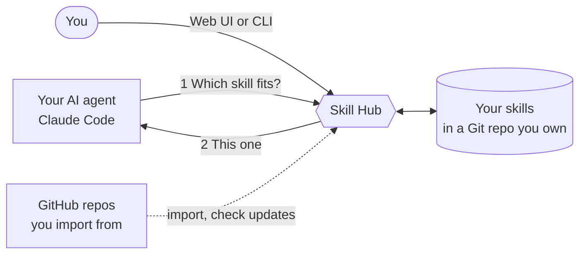

<picture><source media="(prefers-color-scheme: dark)" srcset="docs/images/brand/skill-hub-logo-dark.svg"></picture>
# Skill Hub

One skill library. Every agent. Every project.\
[](https://github.com/vantt/mcp-skill-hub/releases/latest) [](https://github.com/vantt/mcp-skill-hub/actions/workflows/ci.yml) [](LICENSE)\
[Quickstart](#quickstart) · [User guide](docs/user-guide.md) · [Curating skills](docs/curating-skills.md)

Keep your agent skills in one Git repository you own, and stop copying skill folders between projects.
When your agent starts a task, it asks the hub which skill fits, and the hub suggests one. Nothing changes in your library without your say-so.

<picture>
  <source media="(prefers-color-scheme: dark)" srcset="docs/images/web/dark-skills-list.png">
  
</picture>

*Skills: every skill with its state, and filters to find one.*

## Why Skill Hub

- **Your agent asks for the right skill.** It sends a short task description and gets one recommendation, or "no skill fits". The full skill text loads only after the agent picks it.
- **You approve every change.** New skills start as drafts that agents are not offered. Skills from someone else's repository reach your agent only after you approve them in the terminal.
- **One program, nothing to keep running.** Skill Hub is a single binary. Your agent starts it when needed; nothing runs in the background.
- **Git is the database.** Your skills are plain files in your own repository. Review them, share them with teammates, and roll them back with Git.
- **A local web UI.** Browse, review and edit skills in your browser, on your own machine.

## How it works

1. You keep your skills in a workspace: the Git repository that holds your skills.
2. You connect a project, or every project, so your agent finds the hub.
3. Your agent is told to ask the hub which skill fits a task, and the hub answers.



## Quickstart

Install Skill Hub on Linux or macOS with one command.

```bash
curl -fsSL https://github.com/vantt/mcp-skill-hub/releases/latest/download/install.sh | sh
```

<details>
<summary>Windows (PowerShell)</summary>

```powershell
powershell -ExecutionPolicy ByPass -c "irm https://github.com/vantt/mcp-skill-hub/releases/latest/download/install.ps1 | iex"
```

</details>

Open a new terminal and check it with `skillhub version`. Next, create your workspace.

```bash
skillhub init ~/skillhub --yes
```

Commit only the workspace's own files. The connection files `init` writes stay out of Git because they hold paths from your machine.

```bash
git -C ~/skillhub add .gitignore .skillhub/schema-version
git -C ~/skillhub commit -m "Initialize Skill Hub workspace"
```

Connect a project to Claude Code. This writes the connection files into that project folder.

```bash
cd <your-project>
skillhub connect --workspace ~/skillhub --host claude --yes
```

Check the setup. It prints "Workspace is healthy." when everything is in place.

```bash
skillhub doctor
```

Open a new Claude Code session in that folder and ask:

> curate my Skill Hub

Your agent shows the state of your hub and suggests one next step.

> [!TIP]
> Use `skillhub connect -g --workspace ~/skillhub --yes` to connect every project at once.

Add your first skill -> [Get started](docs/getting-started.md)

## See it

Start the web UI from a connected project, on this machine only. It prints a link with a session token; open it in your browser. The [web UI guide](docs/web-ui.md) walks through each task.

```bash
skillhub serve web --loopback-only
```


*Review: whether agents can use this skill, and what to check first.*

## Works with

| Agent | Status |
|---|---|
| Claude Code | Verified ([compatibility matrix](docs/mcp-compatibility-matrix.json)) |
| Codex | `connect` writes connection files; not yet verified end to end |
| Gemini CLI | `connect` writes connection files; not yet verified end to end |

## Documentation

- **Start:** [Get started](docs/getting-started.md) · [Installation](docs/installation.md)
- **Guides:** [Using Skill Hub](docs/user-guide.md) · [Curating skills](docs/curating-skills.md) · [Sources and learning](docs/sources-and-learning.md) · [Web UI](docs/web-ui.md) · [Troubleshooting](docs/troubleshooting.md)
- **Reference:** [Command reference](docs/command-reference.md) · [All docs](docs/README.md)
- **Maintainers:** [Contributing](CONTRIBUTING.md) · [Release runbook](docs/release-runbook.md)

## Contributing and license

To build, test or release Skill Hub, see [CONTRIBUTING.md](CONTRIBUTING.md). Skill Hub is released under the MIT License, see [LICENSE](LICENSE).
