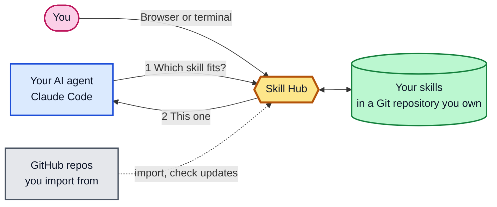

<div align="center">

<h1><picture><source media="(prefers-color-scheme: dark)" srcset="docs/images/brand/skill-hub-logo-dark.svg"></picture></h1>

Your skills in one place. Pulled by any agent, on demand.<br>

[](https://github.com/vantt/skillhub-mcp/releases/latest) [](https://github.com/vantt/skillhub-mcp/actions/workflows/ci.yml) [](LICENSE)

[Tiếng Việt](README.vi.md) · [Quickstart](#quickstart) · [Using Skill Hub](docs/user-guide.md) · [Curating skills](docs/curating-skills.md)

</div>

Skill Hub serves your agent skills over MCP from one Git repository you own, so there is nothing to install or copy into each project: your agent asks the hub for the right skill when a task starts.
Because the library is central, you can collect skills from any repository, edit them, and tune them to your own criteria, with feedback from real use and an approval step before anything reaches an agent.

A note on names: the repository is `skillhub-mcp`, the product is Skill Hub, and the command is `skillhub`.

<picture>
  <source media="(prefers-color-scheme: dark)" srcset="docs/images/web/dark-skills-list.png">
  
</picture>

*Skills: every skill with its state, and filters to find one.*

## How it works

1. You keep your skills in a hub: a folder of its own, kept in a Git repository.
2. You connect your user account once, or a single project, so your agent finds the hub.
3. Your agent is told to ask the hub which skill fits a task, and the hub answers.



## Why Skill Hub

- **No per-project install.** Connect your user account once with `skillhub connect -g` and your project folders stay untouched. Your agent asks the hub for a skill when a task starts, so nothing is copied into each project.
- **Make skills yours.** Collect skills from any repository, edit them, and tune them to your own criteria. Feedback from real use shows which ones help, and new skills start as drafts you approve.
- **One recommendation per task.** Your agent is told to ask the hub with a short task description. It gets one recommendation, or "no skill fits", and the full skill text loads only after it picks one.
- **You approve every skill change.** New skills start as drafts that agents are not offered. Skills from someone else's repository reach your agent only after you approve them in the terminal.
- **One program, nothing to keep running.** Skill Hub is a single binary. Your agent starts it when needed; nothing runs in the background.
- **Git is the database.** Your skills are plain files in your own repository. Review them, share them with teammates, and roll them back with Git.
- **A local web UI.** Browse, review and edit skills in your browser, on your own machine.

## Quickstart

You set up Skill Hub in two steps. First you install the **hub**, the folder that holds your skills. Then you install a **client project**, a project whose agents use the hub. You need Git and an agent such as Claude Code.

### Install

Install Skill Hub on Linux or macOS with one command.

```bash
curl -fsSL https://github.com/vantt/skillhub-mcp/releases/latest/download/install.sh | sh
```

<details>
<summary>Windows (PowerShell)</summary>

```powershell
powershell -ExecutionPolicy ByPass -c "irm https://github.com/vantt/skillhub-mcp/releases/latest/download/install.ps1 | iex"
```

</details>

Open a new terminal, then check that the command works:

```bash
skillhub --version
```

[Installation](docs/installation.md) covers versions, signatures, upgrades and building from source.

### Step 1: Install the hub

The hub is a folder of its own, kept in its own Git repository. Create an empty folder and make it your hub:

```bash
mkdir -p ~/skill-hub && cd ~/skill-hub && skillhub init
```

```text
Hub created at <home>/skill-hub.
Agent connection written: claude-code, codex-cli, gemini-cli.
First commit <commit>: "Initialize Skill Hub hub".
Git hooks and commit signing were skipped for this first commit.
This is now the hub of this machine; `skillhub connect` uses it.

Next: connect a project to this hub:
  $ cd <your-project> && skillhub connect
```

`<home>` stands for your home folder. `init` turned the folder into a Git repository with the hub layout and made the first commit. It also connected the agents you open in that folder, and stored the hub's path for this machine. If Git has no user name or email yet, `init` makes this one commit as `Skill Hub <skillhub@localhost>` and says so.

<details>
<summary>Windows (PowerShell)</summary>

Windows PowerShell 5.1 has no `&&`. Separate the commands with `;` instead:

```powershell
mkdir -Force ~/skill-hub; cd ~/skill-hub; skillhub init
```

</details>

<details>
<summary>Keep the hub on GitHub</summary>

Create an empty repository on GitHub, without a README or license file. Then give its URL to `init` in your hub:

```bash
cd ~/skill-hub && skillhub init <git-url>
```

What `init` does depends on the repository:

- **It is empty:** `init` pushes the hub there and sets it as `origin`. This is the only push Skill Hub ever makes for you.
- **It already holds this hub:** `init` sets it as `origin` and pushes nothing.
- **It holds anything else:** `init` refuses and changes nothing.

After that, you commit and push skill changes with Git yourself.

</details>

<details>
<summary>Use the hub on a second machine</summary>

On the second machine, run `init` in an empty folder with the URL of your hub's repository:

```bash
mkdir -p ~/skill-hub && cd ~/skill-hub && skillhub init <git-url>
```

`init` fetches the hub into the folder, builds its search index and makes it the hub of this machine. To use one hub over the network instead, see [Use one hub from several machines](docs/remote-hub-guide.md).

</details>

### Step 2: Install the client project

A client project is a project whose agents use the hub. Go to a project you work on and connect it:

```bash
cd <your-project> && skillhub connect
```

```text
Connected project <home>/<your-project>
to the hub at <home>/skill-hub.
Agent connection written: claude-code, codex-cli, gemini-cli.
  - Claude Code: connected (.mcp.json, .claude/settings.local.json, system-curator skill, CLAUDE.md)
  - Codex: connected (.codex/config.toml, AGENTS.md)
  - Gemini CLI: connected (.gemini/settings.json, GEMINI.md)
  - Agent Skills folder (.agents/skills): connected (system-curator skill)

Next: restart your agent and ask it: "curate my Skill Hub"
```

Output is trimmed. `connect` finds the hub that `init` stored, and never overwrites your own content in those files. Add `--dry-run` to see what it would write first. [What gets written](docs/user-guide.md#what-gets-written) lists every file.

Restart your agent in that folder and ask it:

> curate my Skill Hub

The curator skill that `connect` installed tells your agent to show the hub's status and one next step. The first time you open the folder, Claude Code shows a trust dialog that lists `Bash(skillhub:*)`.

> [!TIP]
> Run `skillhub connect -g` to connect every project of your user account at once.

<details>
<summary>Windows (PowerShell)</summary>

```powershell
cd <your-project>; skillhub connect
```

</details>

<details>
<summary>Use a hub on another machine</summary>

On the machine that holds the hub, start the server:

```bash
cd ~/skill-hub && skillhub serve
```

For each address the other machine can use, it prints two lines to run there: an `scp` line that copies the hub's token file, and the `connect` line. Run both on the other machine, the `connect` line inside your project:

```bash
cd <your-project> && skillhub connect --hub <url> --token-file <file>
```

`serve` listens on every network interface over plain HTTP. On a network you do not trust, use the SSH tunnel setup instead. The token file lets that machine's agents use the hub; it is one of [two kinds of token](docs/remote-hub-guide.md#two-kinds-of-token). [Use one hub from several machines](docs/remote-hub-guide.md) explains every step.

</details>

### Check

`skillhub status` shows the state of the hub and of this folder's connections. It always ends with the one command to run next.

```bash
cd <your-project> && skillhub status
```

```text
Hub at <home>/skill-hub
Status:     Skill Hub is up to date.
Health:     Workspace valid; search index current; Git clean.
Inventory:  No skills yet.

This project uses this hub

Check        Status  Detail
Claude Code  ok      project entry in .mcp.json
Codex        ok      project entry in .codex/config.toml
Gemini CLI   ok      project entry in .gemini/settings.json

Next: create your first skill (you will be asked a few questions):
  $ skillhub skill create
```

When something is wrong, `status` names it. These are the common cases and their fix:

- "No hub is set up on this machine": create one with `mkdir -p ~/skill-hub && cd ~/skill-hub && skillhub init`.
- "This folder is not a Skill Hub hub or a connected project": connect it with `skillhub connect`.
- "Nothing answers at `<url>`" for a hub on another machine: on that machine, run `cd ~/skill-hub && skillhub serve`.
- "The hub folder `<path>` is gone": run `cd <new-location> && skillhub init` where the hub is now, then `skillhub doctor --fix` in each project.
- Connection files or Claude Code permission rules are out of date: run `skillhub doctor --fix`.

[Troubleshooting](docs/troubleshooting.md) covers every message, step by step.

Next: [create your first skill](docs/curating-skills.md#create-your-first-skill).

## See it

Start the web UI from your hub, on this machine only. It prints a link with a session token; open it in your browser. The [web UI guide](docs/web-ui.md) walks through each task.

```bash
cd ~/skill-hub && skillhub serve web --addr 127.0.0.1:7421
```


*Review: whether agents can use this skill, and what to check first.*

## Works with

| Agent | Status |
|---|---|
| Claude Code | Verified ([compatibility matrix](docs/mcp-compatibility-matrix.json)) |
| Codex | `connect` writes connection files; not yet verified end to end |
| Gemini CLI | `connect` writes connection files; not yet verified end to end |

## Documentation

- **Start:** [Quickstart](#quickstart) · [Installation](docs/installation.md)
- **Guides:** [Using Skill Hub](docs/user-guide.md) · [Curating skills](docs/curating-skills.md) · [Sources and learning](docs/sources-and-learning.md) · [Web UI guide](docs/web-ui.md) · [One hub from several machines](docs/remote-hub-guide.md) · [Troubleshooting](docs/troubleshooting.md)
- **Reference:** [Command reference](docs/command-reference.md) · [All docs](docs/README.md)
- **Maintainers:** [Contributing](CONTRIBUTING.md) · [Release runbook](docs/release-runbook.md)

## Contributing and license

To build, test or release Skill Hub, see [CONTRIBUTING.md](CONTRIBUTING.md). Skill Hub is released under the MIT License; see [LICENSE](LICENSE).
