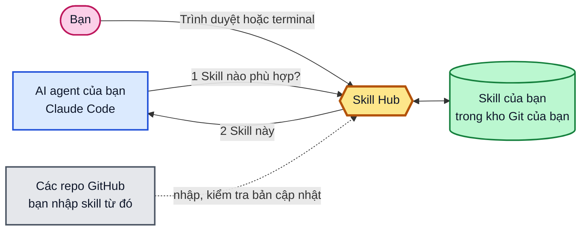

<div align="center">

<h1><picture><source media="(prefers-color-scheme: dark)" srcset="docs/images/brand/skill-hub-logo-dark.svg"></picture></h1>

Skill của bạn ở một nơi. Mọi agent kéo về khi cần.<br>

[](https://github.com/vantt/skillhub-mcp/releases/latest) [](https://github.com/vantt/skillhub-mcp/actions/workflows/ci.yml) [](LICENSE)

[English](README.md) · [Bắt đầu nhanh](#bắt-đầu-nhanh) · [Dùng Skill Hub](docs/user-guide.md) · [Quản lý skill](docs/curating-skills.md)

</div>

Skill Hub phục vụ các skill của agent qua MCP từ một kho Git của riêng bạn, nên không có gì phải cài hay sao chép vào từng dự án: agent hỏi hub skill phù hợp khi bắt đầu một việc.
Vì thư viện nằm một chỗ, bạn có thể thu thập skill từ bất kỳ kho nào, chỉnh sửa và tinh chỉnh theo tiêu chí của riêng bạn, kèm phản hồi từ việc dùng thật và một bước duyệt trước khi bất cứ thứ gì đến tay agent.

<picture>
  <source media="(prefers-color-scheme: dark)" srcset="docs/images/web/dark-skills-list.png">
  
</picture>

*Skills: mọi skill kèm trạng thái, và bộ lọc để tìm.*

## Bắt đầu nhanh

Bạn cần Git và một agent như Claude Code. Thiết lập mất khoảng hai phút.

### 1. Cài đặt

```bash
curl -fsSL https://github.com/vantt/skillhub-mcp/releases/latest/download/install.sh | sh
```

<details>
<summary>Windows (PowerShell)</summary>

```powershell
powershell -ExecutionPolicy ByPass -c "irm https://github.com/vantt/skillhub-mcp/releases/latest/download/install.ps1 | iex"
```

PowerShell 5.1 không có `&&`: hãy viết mỗi lệnh dưới đây trên một dòng riêng, hoặc nối bằng `;`.

</details>

Mở một terminal mới và chạy `skillhub --version` để kiểm tra.

### 2. Thiết lập

Chọn trường hợp phù hợp với bạn.

#### Một máy

```bash
mkdir -p ~/skill-hub && cd ~/skill-hub && skillhub init
skillhub connect -g
```

Khởi động lại agent và nói: **curate my Skill Hub**. Xong: mọi dự án bạn mở giờ đều dùng hub của bạn.

#### Hub ở một máy, agent ở máy khác

Cả hai máy cần [Tailscale](https://tailscale.com) (hoặc một đường hầm SSH tới máy hub). Cài Skill Hub trên cả hai máy, rồi:

**Trên máy hub.** Tạo hub như trên (`init`), rồi khởi động server và để nó chạy:

```bash
cd ~/skill-hub && skillhub serve
```

Ở một terminal thứ hai, tạo mã dùng một lần:

```bash
cd ~/skill-hub && skillhub token invite
```

Nó in ra một dòng sẵn để dán, ví dụ:

```text
skillhub connect --hub http://100.121.46.35:7420 --invite K7QF-9M2X-4TBD
```

**Trên máy agent.** Dán dòng đó trong dự án của bạn, rồi khởi động lại agent:

```bash
cd <dự-án-của-bạn> && skillhub connect --hub http://100.121.46.35:7420 --invite K7QF-9M2X-4TBD
```

Mã chỉ dùng được một lần và hết hạn sau 10 phút; chạy lại `token invite` để lấy mã mới. Máy agent không giữ skill nào, chỉ có một file token trong thư mục cấu hình của Skill Hub. Thêm `-g` vào dòng đã dán để áp dụng cho mọi dự án.

### 3. Kiểm tra

```bash
skillhub doctor
```

Nó cho biết cái gì hoạt động và in một cách sửa cho mỗi mục lỗi. `skillhub doctor --fix` sửa những gì có thể. [Hướng dẫn xử lý sự cố](docs/troubleshooting.md) giải thích từng thông báo.

**Tiếp theo:** [tạo skill đầu tiên](docs/curating-skills.md#create-your-first-skill).

Xem thêm: [giữ hub trên GitHub](docs/user-guide.md#keep-the-hub-on-github) · [chạy server nền, dùng đường hầm SSH, xoay token](docs/remote-hub-guide.md) · [chi tiết cài đặt](docs/installation.md)

## Cách hoạt động

1. Skill của bạn nằm trong một hub: một thư mục trong kho Git của riêng bạn.
2. Bạn kết nối agent với hub một lần.
3. Khi bắt đầu một việc, agent hỏi hub skill nào phù hợp, và hub trả lời.




## Vì sao dùng Skill Hub

- **Không phải cài theo từng dự án.** Kết nối một lần; không có thư mục skill nào để sao chép đi khắp nơi.
- **Biến skill thành của bạn.** Thu thập skill từ bất kỳ kho nào, chỉnh sửa, tinh chỉnh theo tiêu chí của bạn. Skill mới bắt đầu ở trạng thái nháp để bạn duyệt.
- **Mỗi việc một gợi ý.** Nội dung đầy đủ của skill chỉ được tải sau khi agent chọn.
- **Git là cơ sở dữ liệu.** Các file thường trong kho của riêng bạn: xem lại, chia sẻ và hoàn tác bằng Git.
- **Giao diện web cục bộ** để duyệt, xem xét và sửa skill.

## Xem thử

Khởi động giao diện web từ hub của bạn, chỉ trên máy này. Nó in ra một liên kết kèm token phiên; hãy mở nó trong trình duyệt. [Hướng dẫn giao diện web](docs/web-ui.md) đi qua từng tác vụ.

```bash
cd ~/skill-hub && skillhub serve web --addr 127.0.0.1:7421
```


*Review: agent có dùng được skill này không, và nên kiểm tra gì trước.*

## Hoạt động với

| Agent | Trạng thái |
|---|---|
| Claude Code | Đã kiểm chứng ([ma trận tương thích](docs/mcp-compatibility-matrix.json)) |
| Codex | `connect` ghi các file kết nối; chưa kiểm chứng đầu-cuối |
| Gemini CLI | `connect` ghi các file kết nối; chưa kiểm chứng đầu-cuối |

## Tài liệu

Tài liệu chi tiết hiện chỉ có tiếng Anh.

- **Bắt đầu:** [Bắt đầu nhanh](#bắt-đầu-nhanh) · [Cài đặt](docs/installation.md)
- **Hướng dẫn:** [Dùng Skill Hub](docs/user-guide.md) · [Quản lý skill](docs/curating-skills.md) · [Nguồn và học](docs/sources-and-learning.md) · [Hướng dẫn giao diện web](docs/web-ui.md) · [Một hub từ nhiều máy](docs/remote-hub-guide.md) · [Xử lý sự cố](docs/troubleshooting.md)
- **Tham chiếu:** [Tham chiếu lệnh](docs/command-reference.md) · [Toàn bộ tài liệu](docs/README.md)
- **Người bảo trì:** [Đóng góp](CONTRIBUTING.md) · [Quy trình phát hành](docs/release-runbook.md)

## Đóng góp và giấy phép

Để biên dịch, kiểm thử hoặc phát hành Skill Hub, xem [CONTRIBUTING.md](CONTRIBUTING.md). Skill Hub được phát hành theo Giấy phép MIT; xem [LICENSE](LICENSE).
