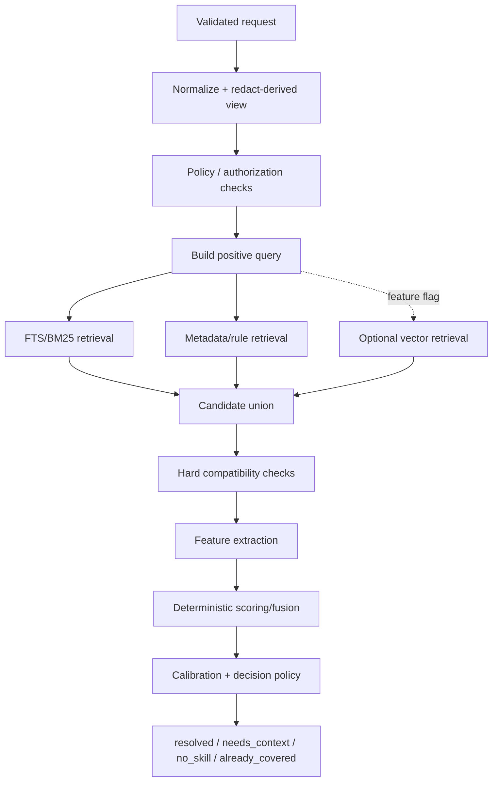
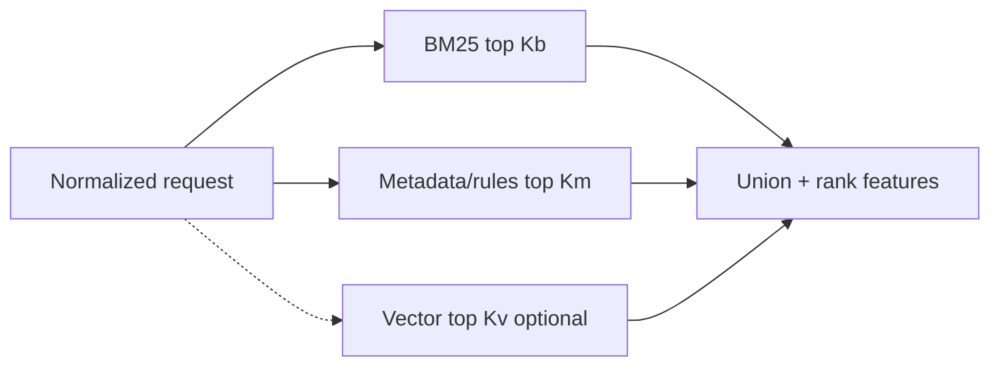
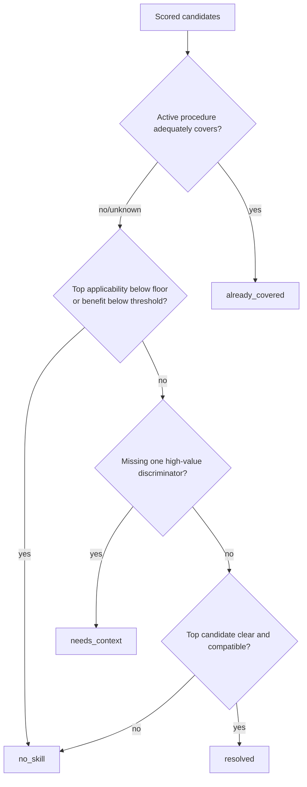
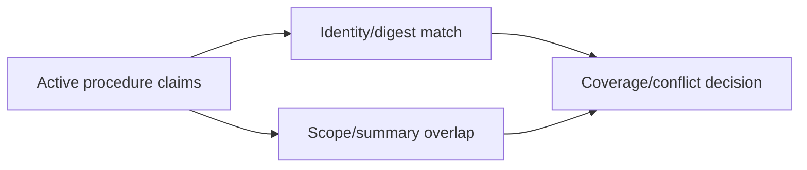

# Thiết kế chi tiết Resolver

**Trạng thái:** Deterministic-first V1  
**Phạm vi:** Index documents, candidate generation, scoring, ambiguity, abstention, workspace facts và optional LLM/vector extensions  
**Protocol:** [Agent ↔ Hub](02-agent-hub-protocol.md)

## 1. Mục tiêu và invariants

Resolver tối ưu **expected task benefit**, không tối ưu tỷ lệ luôn trả một skill.

```text
recommend S khi:
  applicability(S)
  + expected incremental benefit(S)
  - activation/context cost(S)
  - constraint/capability risk(S)
  đủ cao so với tiếp tục không dùng skill
```

V1 không cần utility model hoàn hảo nhưng phải giữ các invariants:

1. Task-local evidence > ambient repository facts.
2. Constraint/user scope không bị positive retrieval lấn át.
3. Unknown ≠ false ≠ true.
4. Semantic hints của agent không hard-filter.
5. Một large score margin không chứng minh candidate có liên quan tuyệt đối.
6. Tie giữa near-duplicates không nhất thiết cần hỏi user.
7. `no_skill` là first-class result.
8. Cùng request + catalog snapshot + policy revision phải cho cùng deterministic result.

## 2. Pipeline



Không có hard hierarchical classifier trước retrieval. Có thể search family index để tăng tốc nhưng luôn giữ global fallback.

## 3. Routing metadata

`skill.meta.yaml` định hướng:

```yaml
id: consumer-reliability-review
name: Consumer Reliability Review
status: active
description: Review retry, acknowledgement and duplicate-processing behavior.
topics: [messaging, reliability]
technologies: [kafka, rabbitmq, go]

routing:
  operations: [review, debug]
  triggers:
    - review retry and idempotency handling in a message consumer
    - investigate duplicate handling after consumer restart
    - check acknowledgement ordering around side effects
  examples:
    - check message consumer for idempotent message processing
    - verify acknowledgement occurs after database transaction commit
    - investigate duplicate message handling upon consumer restart
  counter_examples:
    - design a new event-driven service topology
    - tune broker cluster configuration
  not_for:
    - design a new event-driven service topology
    - tune broker cluster configuration
  min_scope: multi_step
  requirements:
    facts:
      any:
        - { key: dependency, value: kafka }
        - { key: dependency, value: rabbitmq }
        - { key: dependency, value: sqs }
    capabilities:
      all: [read-files]

  boosts:
    artifact_kind: [source-file, pull-request, diff]
    fact:
      - { key: dependency, value: kafka, weight: 0.10 }

  distinguish_from:
    - skill: event-driven-architecture-review
      discriminator:
        field: task.scope
        question: Is the task limited to consumer behavior or does it change service boundaries?
        choices: [consumer-only, service-boundaries, unknown]

  supporting:
    - skill: idempotency-test-design
      when:
        operation: test
      role: Design tests for retry and duplicate paths
      activation: on-demand

quality:
  reviewed: true
```

### Validation rules

Active skill phải có:

- stable `id`, name, description;
- ít nhất một trigger/activation example;
- `not_for` hoặc explicit empty + review rationale;
- min scope;
- valid requirement semantics;
- mọi relationship target tồn tại và không self-cycle bất hợp lệ;
- discriminator field/question/choices nhất quán nếu khai báo.

Không bắt `distinguish_from` với mọi cặp.

### Metadata linting rules (warnings)

Hệ thống cung cấp các quy tắc lint metadata tự động khi chạy `skillhub maintain validate`, `skillhub skill review`, bản xem trước của `skillhub skill commit` và màn hình Review trên web. Các cảnh báo này **không bao giờ làm hỏng hay chặn validation** (exit code 0 nếu không có lỗi cấu trúc):

| Mã cảnh báo | Điều kiện kích hoạt | Hướng dẫn khắc phục (`fix`) |
|---|---|---|
| `trigger_collision` | Triggers giữa 2 skill overlap $\ge 0.8$ (hoặc trùng lặp sau normalize) mà không có quan hệ `distinguish_from`, `equivalent_to`, hoặc `not_for`/`counter_examples` giữa chúng (overlap $\ge 0.5$) | Thêm `distinguish_from` hoặc thu hẹp trigger |
| `generic_trigger` | Toàn bộ token trong trigger đều thuộc stoplist chung (`code, coding, help, fix, task, work, write, create, update, change, build, make, do, run, use, general, stuff, thing, project, app, file, review, test, debug, issue, problem`) hoặc $< 2$ tokens | Bổ sung danh từ domain cụ thể cho trigger |
| `missing_examples` | Active skill có ít hơn 3 `routing.examples` | Bổ sung 3–5 câu mô tả tác vụ tự nhiên |
| `example_restates_trigger` | Một example overlap $\ge 0.9$ với trigger của chính skill đó | Diễn đạt lại theo ngữ cảnh tác vụ thực tế |
| `near_duplicate` | Hai active skills có tập token description + triggers overlap $\ge 0.6$ mà không có quan hệ phân định giữa chúng | Bổ sung `distinguish_from`, `equivalent_to` hoặc gộp skill |
| `example_resolves_elsewhere` | Một example của skill, khi chạy qua resolver với skill ở trạng thái đang xét (đã bật), không ra chính skill đó: ra skill khác (`OtherSkillID` là skill thắng), cần chọn giữa các skill, hoặc không ra skill nào | Thêm `not_for` cho skill thắng, thêm `distinguish_from`, thu hẹp trigger, hoặc diễn đạt lại example |
| `counter_example_resolves_to_skill` | Một `counter_examples` của skill vẫn ra chính skill đó | Thêm `not_for` bao phủ yêu cầu này, hoặc thu hẹp trigger đang khớp |
| `example_taken_by` | Example của skill Y nay ra skill X vừa thay đổi (hoặc X và Y cùng vào lựa chọn). `SkillID` là X, `OtherSkillID` là Y; thông điệp ghi "now" (mới xảy ra) hoặc "already" (trước thay đổi đã như vậy) | Thêm `not_for` cho X, thu hẹp trigger của X, hoặc thêm `distinguish_from` giữa X và Y |
| `self_resolution_skipped` | Bước kiểm tra example bị bỏ qua: vượt giới hạn công việc, `config/recommendation.yaml` (policy) đổi, hoặc resolver từ chối một skill chưa đủ trường routing | Đổi ít skill hơn mỗi lần, chạy `skillhub maintain validate --full` sau khi rebuild, hoặc điền đủ trường routing bắt buộc |

*Ghi chú:* Việc kiểm tra theo cặp có độ phức tạp $O(n^2)$; nếu số lượng active skills vượt quá 2.000, bước kiểm tra cặp sẽ được bỏ qua với cảnh báo `lint_pairs_skipped`.

#### Kiểm tra example qua resolver

Bốn mã cuối bảng không đo độ giống nhau của chữ mà **chạy resolver thật** trên example, trong bộ nhớ và không ghi gì (không đổi catalog, telemetry hay con trỏ generation). Thư viện được lấy từ generation đang phục vụ, rồi phủ lên phiên bản mới của skill đang xét (overlay), nên review một skill chưa rebuild hay một thư mục chưa commit vẫn được kiểm tra như thể skill đã active. Mỗi example được resolve với chính nó bị loại khỏi skill chủ và khỏi index tìm kiếm (FTS của generation, hoặc tập từ của overlay nếu chủ nằm trong overlay), giống `skillhub eval routing`, và skill `system-curator` của hệ thống không bao giờ là chủ của một case.

Những case được chạy cho một thay đổi (*affected examples*):

- toàn bộ `routing.examples` và `routing.counter_examples` của chính skill đã đổi;
- `routing.examples` của skill khác mà skill đã đổi **có thể ảnh hưởng đến quyết định**: skill mới sẽ là ứng viên với điểm từ ngưỡng `ApplicabilityFloor` trở lên, là runner-up liên kết qua `distinguish_from` trong biên cho phép, hoặc bị loại cứng nhưng độ liên quan vẫn đạt ngưỡng (có thể biến kết quả thành `constraint_conflict`). `counter_examples` của skill khác không được chọn, vì skill đã đổi thắng một counter-example không gây hại cho chủ của nó.

Một case của skill khác chỉ được báo khi nó sai **và** skill đã đổi tham gia vào quyết định (thắng, hoặc nằm trong top 2 của kết quả cần chọn). Trạng thái "trước thay đổi" chỉ được resolve cho các case sẽ được báo, để quyết định chữ `now` hay `already`.

Các chế độ của `skillhub maintain validate`:

| Chế độ | Phạm vi |
|---|---|
| mặc định (changed) | Skill thay đổi so với `HEAD` (working tree, gồm cả file chưa theo dõi). Cây sạch thì không chạy gì. Chưa có commit nào thì kiểm tra mọi skill active |
| `--staged` | Skill có file trong Git index, đọc trực tiếp blob của index. Dùng trong pre-commit hook; không lấy commit lock (`runtime/locks/commit.lock`) |
| `--full` | Example riêng của mọi skill active; không tìm "bị skill khác lấy" vì không có skill nào thay đổi. Không dùng cùng `--staged` (exit 2) |

Cả ba chế độ chỉ phát cảnh báo, không đổi exit code. Chế độ changed và `--full` cần generation đang phục vụ khớp với file; nếu cũ thì chỉ có `lint_skipped` yêu cầu rebuild. Khi `config/recommendation.yaml` đổi, mọi kết quả cũ không còn so sánh được, nên chỉ phát một `self_resolution_skipped` hướng tới `skillhub maintain rebuild` rồi `skillhub maintain validate --full`.

**Giới hạn công việc.** Một lần chạy bị chặn ở `số example × số skill active ≤ 60000` (hằng `maxSelfResolutionWork`). Đo trên corpus 42 skill, một lần chạy đầy đủ mất khoảng 1,35 giây; với 256 skill khoảng 0,65 giây. Vượt giới hạn thì phát một `self_resolution_skipped` thay vì chạy nửa vời.

**Khoảng hở đã biết.** Retrieval của resolver giới hạn mỗi kênh ở `CandidateLimit` = 40. Khi có hơn 40 skill active, một skill mới vào danh sách đã bị cắt có thể đẩy một skill khác ra khỏi top 2 mà điều kiện ảnh hưởng ở trên không mô hình hóa. Trường hợp này chỉ `skillhub maintain validate --full` (hoặc `skillhub eval routing`) bắt được.
## 4. Index design

### 4.1 SQLite tables định hướng

```text
skills
skill_versions
routing_documents
routing_triggers
routing_exclusions
skill_requirements
skill_relationships
resource_manifests
catalog_snapshots
```

Các tables này nằm trong immutable catalog generation được build từ canonical files, không được row-by-row update như durable state. Operational/telemetry tables nằm ở database riêng và không tham gia durable policy. Storage authority/generation lifecycle nằm trong [07-storage-and-mutation-model.md](07-storage-and-mutation-model.md).

### 4.2 FTS document

Mỗi skill có document metadata trong bảng ảo `skill_fts` (`DerivedSchemaVersion = 3`):

```text
skill_fts(skill_id UNINDEXED, name, aliases, description, triggers, examples, keywords)
```

Trọng số BM25 được định nghĩa tường minh cho cả 7 cột:
`bm25(skill_fts, 0.0, 8.0, 5.0, 7.0, 1.0, 3.0, 2.0)`

| Cột | Trọng số BM25 | Ý nghĩa |
|---|---:|---|
| `skill_id` | `0.0` | UNINDEXED, không tính điểm |
| `name` | `8.0` | Tên chính thức của skill (high boost) |
| `aliases` | `5.0` | Các tên gọi phụ/bí danh |
| `description` | `7.0` | Mô tả mục đích sử dụng |
| `triggers` | `1.0` | Các cụm từ kích hoạt (baseline weight) |
| `examples` | `3.0` | Toàn bộ `routing.examples` nối bằng khoảng trắng |
| `keywords` | `2.0` | `topics` + `technologies` nối bằng khoảng trắng |

`counter_examples` và `not_for` **không được đưa vào index FTS** để tránh tạo ra ứng viên giả cho các truy vấn phủ định.

### 4.3 Normalization

- Unicode normalization và case folding.
- Stable tokenization theo ngôn ngữ được hỗ trợ.
- Alias/synonym map nằm trong Git.
- Không stemming hoặc synonym expansion mù quáng nếu làm mất technical token.
- Path chỉ đóng góp basename/kind có kiểm soát; không index username/absolute path.

### 4.4 Tách routing catalog khỏi source-learning index

Source observations, comparisons, distill reports và pending insights có thể có derived FTS riêng cho curation/consult, nhưng **không tự trở thành normal skill candidates**. Chỉ active curated skill metadata đi vào resolver index.

Bundled system skills như curator/distiller/applier dùng reserved identity và `explicit-only` activation. Chúng được bootstrap bởi curation intent/instructions, không cạnh tranh score với user-task skills.

Không thêm vector/search infrastructure chỉ để phục vụ source learning nếu FTS + structured evidence lookup chưa chứng minh thiếu. Chi tiết learning entities ở [06-source-learning-and-distillation.md](06-source-learning-and-distillation.md).

## 5. Candidate generation

### 5.1 Positive query

Nguồn:

1. `task.description`.
2. Execution signal summary nếu liên quan trực tiếp.
3. Active artifact kind/language.
4. Selected factual values có routing allowlist.
5. `operation` như soft channel.

Không đưa constraints vào positive query. Không đưa full dependency inventory.

### 5.2 Parallel channels



Defaults phải tune bằng eval. Ví dụ prototype có thể bắt đầu `Kb=30`, `Km=30`; đây không phải contract.

### 5.3 Rule retrieval

Rule channel đưa skill vào candidate set khi:

- exact alias/identity match từ explicit user choice;
- strong artifact/capability mapping;
- active procedure identity/provenance liên quan;
- declared relationship từ một primary đang xét;
- deterministic fact match.

Rule retrieval không đồng nghĩa resolved; candidate vẫn qua applicability checks.

## 6. Compatibility và tri-state logic

Mọi requirement fact có ba trạng thái:

```text
SATISFIED | VIOLATED | UNKNOWN
```

| Requirement | Satisfied | Violated | Unknown |
|---|---|---|---|
| Required capability | capability có | host khai báo không có | không khai báo |
| Required fact | observed match | observed contradictory fact trong cùng scope | chưa quan sát |
| Authorization | policy allow | policy deny | policy unavailable |

Decision:

- `VIOLATED` trên hard requirement → loại candidate.
- `UNKNOWN` trên safety/capability-critical requirement → không resolve; có thể hỏi.
- `UNKNOWN` trên relevance enhancer → không boost/penalize nhẹ, không coi là violation.
- `SATISFIED` → compatibility pass/boost theo policy.

Hard rules chỉ cho disabled/unauthorized/incompatible facts được xác nhận. Agent-inference không đủ để tạo hard pass/fail.

## 7. Feature model

V1 dùng interpretable features:

| Feature | Range | Ý nghĩa |
|---|---:|---|
| `lexical_task` | 0..1 | BM25 task ↔ metadata/triggers normalized |
| `trigger_match` | 0..1 | Best/aggregate activation example match |
| `artifact_match` | 0..1 | Artifact kind/language relevance |
| `fact_match` | 0..1 | Scoped observed facts support |
| `operation_match` | 0..1 | Soft enum agreement |
| `quality_prior` | 0..1 | Human-reviewed status; low weight |
| `constraint_conflict` | 0..1 | Constraint vs purpose/not_for conflict |
| `not_for_match` | 0..1 | Task resembles negative examples |
| `scope_cost` | 0..1 | Skill overhead vs task size |
| `missing_critical` | boolean | Required evidence unknown |
| `semantic_task` | 0..1 | Optional vector channel |

Feature values và reasons được log ở runtime theo privacy policy; không trả internal model rationale đầy đủ cho agent.

### 7.1 Score skeleton

```text
base =
    w_lexical  * lexical_task
  + w_trigger  * trigger_match
  + w_artifact * artifact_match
  + w_fact     * fact_match
  + w_operation* operation_match
  + w_quality  * quality_prior
  + w_semantic * semantic_task

penalty =
    p_constraint * constraint_conflict
  + p_not_for    * not_for_match
  + p_scope      * scope_cost

score = clamp(base - penalty, 0, 1)
```

Weights không được hard-code rải rác. Chúng nằm trong `config/recommendation.yaml`, có policy revision và được thay qua reviewed change.

- **Trigger feature:** tính bằng `max(bestOverlap(query, Triggers), 0.9 × bestOverlap(query, Examples))`. Khi example thắng và $\ge 0.3$, gán mã lý do `example_match`. Rank của kênh rule-channel dùng chung giá trị kết hợp này.
- **Not-for feature:** tính bằng `max(bestOverlap(query, NotFor), bestOverlap(query, CounterExamples))`, chia sẻ ngưỡng soft penalty ($\ge 0.35 \to \text{unknown}$) và hard exclusion ($\ge 0.72 \to \text{violated}$).
- **Lexical tokens:** bổ sung thêm `topics` và `technologies` vào tập từ khóa metadata.
- **Technology matching:** khớp `technologies` với `ActiveArtifact.Language` hoặc các facts thuộc danh sách `language, framework, library, dependency, technology, runtime, platform`. Khi khớp, nâng artifact feature lên $\max(\text{current}, 1.0)$ và gán lý do `technology_match` (không phạt khi không khớp).

BM25/vector raw scores phải normalize theo method versioned. `score` là ranking score, không tự nhận là probability.
### 7.2 Ambient fact cap

Tổng boost từ workspace facts không được vượt task/trigger evidence. Config nên có cap:

```yaml
feature_caps:
  ambient_workspace_facts: 0.15
  operation_hint: 0.10
```

Mục tiêu: repo có Kafka không khiến task sửa README bị route vào Kafka skill.

## 8. Decision policy



### 8.1 `resolved`

Chỉ khi:

- top candidate qua hard compatibility;
- absolute applicability/benefit qua floor;
- confidence band đạt policy yêu cầu;
- không thiếu safety/capability evidence critical;
- ambiguity không thay đổi workflow materially, hoặc canonical equivalent preference giải quyết được.

### 8.2 `needs_context`

Chỉ hỏi nếu:

- có một field/fact cụ thể chưa biết;
- answer có khả năng đổi primary hoặc abstention;
- server có câu hỏi bounded, dễ trả lời;
- clarification budget còn.

Chọn câu hỏi có expected information gain lớn nhất:

```text
EIG(q) ≈ current decision loss
         - Σ P(answer) * expected loss after answer
         - interruption cost(q)
```

V1 có thể dùng heuristic: discriminator được curate + candidate score gần + answer partitions candidates rõ. Không cần probabilistic model đầy đủ.

### 8.3 Near-duplicates/equivalents

Nếu candidates tương đương về workflow và cùng acceptable set:

- dùng canonical preference/pin/version policy;
- ghi duplicate warning;
- không hỏi agent/user câu không ảnh hưởng execution.

Nếu workflows khác nhau và thiếu discriminator: `needs_context`. Nếu không có discriminator tốt: `no_skill: unresolved_ambiguity`, không đưa shortlist ở V1.

### 8.4 `no_skill`

Return khi dưới absolute floor, below min scope, constraint/capability conflict, catalog gap hoặc ambiguity không giải quyết trong budget.

Không dùng margin đơn độc: một candidate tệ có thể thắng với margin lớn.

## 9. Confidence và calibration

Tách ba khái niệm:

1. **Applicability:** skill có phù hợp task không?
2. **Selection uncertainty:** có workflow khác cũng plausible không?
3. **Expected benefit:** activation có đáng cost không?

External response trả `high|medium`, không expose pseudo-probability. Internal calibration được fit trên held-out eval set, ví dụ isotonic/Platt nếu dữ liệu đủ. Khi chưa đủ dữ liệu, dùng conservative deterministic thresholds.

`recommendation.yaml` lưu:

```yaml
policy_version: 1
normalization_version: bm25-v1
weights: { ... }
thresholds:
  applicability_floor: 0.55
  high_confidence: 0.80
  minimum_margin: 0.12
calibration:
  method: none
  artifact: null
```
Các số trên chỉ minh họa. Mọi thay đổi phải kèm eval report và catalog snapshot.

Hiệu chuẩn chính sách tuyển chọn (calibration grid search) qua 162 điểm tham số đã chứng minh trọng số `weights.trigger: 0.44` và `weights.not_for_penalty: 0.36` tăng Precision@1 thêm +0.0244 và Recall thêm +0.0238 mà không làm thoái hóa bất kỳ chỉ số gate nào (chi tiết tại báo cáo routing calibration report).
## 10. Supporting skill selection

Chỉ xét supporting sau khi primary được chọn. Candidate supporting phải:

- có relationship curated (`requires`, `supporting`, `usually_followed_by` có điều kiện);
- giải quyết distinct sub-procedure;
- không conflict primary/constraints/capabilities;
- có applicability evidence độc lập;
- giới hạn tối đa hai;
- mặc định `on-demand`.

Không graph-expand recursively. Không synthesize package. Operation đổi (review → implement → test) thường trigger resolution mới thay vì preload kế hoạch nhiều skill.

## 11. Active local procedure handling

Resolver chỉ biết claims host gửi:



- Exact same identity/version: tránh duplicate activation.
- Same provenance/different digest: xem là pinned/fork state, không tự chọn newest.
- Summary/scope bao phủ rõ: có thể `already_covered` với basis `host-declared`.
- Không đủ evidence: không tuyên bố coverage; hỏi hoặc abstain nếu overlap nguy hiểm.
- `supplement-only`: chỉ trả supporting scope riêng, không primary replacement.

## 12. Workspace fact derivation

Optional fact provider interface:

```go
type FactProvider interface {
    Detect(ctx context.Context, req DetectionRequest) ([]Fact, error)
}
```

Providers có thể phát hiện package manifests, framework dependency, Dockerfile, OpenAPI, migrations hoặc test framework. Quy tắc:

- explicit permission và root containment;
- budget file count/bytes/time;
- active-component first;
- no source body persistence;
- cache key gồm root identity + relevant file digest/mtime + provider version;
- facts có provenance/freshness;
- failure không làm resolver ngừng nếu request tự đủ evidence.

## 13. Optional vector retrieval

Vector là plugin channel, tắt mặc định đến khi eval chứng minh lợi ích.

Interface:

```go
type SemanticRetriever interface {
    Search(ctx context.Context, query string, snapshot SnapshotID, limit int) ([]Hit, error)
}
```

Requirements:

- embeddings do Hub tạo bằng model/version pin, không nhận arbitrary client vectors;
- trigger/examples được embed, không mặc định full skill;
- index derived và rebuildable;
- model artifact có immutable identity và distribution policy;
- failure degrade về lexical/rules, reason code ghi channel unavailable;
- vector chỉ re-rank candidate mà lexical (BM25) đã match, không tự thêm candidate mới: RRF cộng điểm theo thứ hạng, nên một channel luôn trả đủ k hit sẽ đẩy skill không liên quan vào kết quả;
- hit có similarity ≤ 0 bị loại trước fusion;
- eval bật vector phải có case `no_skill` và chứng minh vector không làm mất abstention;
- chỉ bật nếu held-out quality gain vượt cost/size/latency threshold đã định.

So sánh tối thiểu: BM25 baseline vs BM25+vector trên cùng candidate/ranker và corpus.

## 14. Optional LLM fallback

MVP: disabled.

Chỉ được gọi khi:

1. Top candidates đều qua applicability floor.
2. Không thiếu fact có thể hỏi.
3. Workflows khác nhau và deterministic ranker chưa phân biệt.
4. Privacy/deployment policy cho phép.
5. Eval chứng minh incremental downstream benefit.

Input: minimized request + tối đa N curated cards (id, description, triggers/not_for, requirements). Không gửi full skills/upstream metadata. Output constrained:

```json
{ "decision": "pick|none|ask", "skill_id": "...", "question_id": "..." }
```

Timeout/error → deterministic result nếu vẫn đạt threshold; nếu không, `no_skill: unresolved_ambiguity` hoặc infrastructure error theo failure type. Không fallback sang agent shortlist.

## 15. Caching và concurrency

Cache keys bao gồm:

```text
request_fingerprint
+ catalog_snapshot
+ policy_revision
+ derived_fact_snapshot
+ activation_context_fingerprint
```

Không cache raw secrets/text làm key plaintext; dùng keyed hash khi cần. `no_skill` cache ngắn trong task/session scope. Catalog mutation tạo snapshot mới, không mutate cache entries cũ.

Resolver đọc immutable catalog generation được pin bởi `runtime/catalog/current.json`. Rebuild tạo generation file mới, validate rồi atomically swap pointer; không replace/truncate live DB. In-flight requests hoàn thành trên old generation và old files được GC sau. Cross-process workspace writer lock bảo đảm một rebuild/mutation writer. Chi tiết ở [07-storage-and-mutation-model.md](07-storage-and-mutation-model.md).

## 16. Explainability

Reason codes công khai:

```text
task_match
trigger_match
artifact_match
fact_match
authorization_pass
constraint_penalty
not_for_penalty
below_min_scope
missing_required_capability
active_procedure_coverage
```

Debug UI có thể xem feature values đã sanitize. Agent chỉ cần applicability và reason codes ngắn. Không expose chain-of-thought hoặc raw LLM reasoning.

## 17. Test strategy

### Unit

- tri-state requirements;
- score normalization/fusion;
- constraint separation;
- snapshot fingerprints;
- loop budgets;
- deterministic tie-breaking.

### Property/metamorphic

- thêm irrelevant repo fact không đổi recommendation;
- paraphrase giữ outcome trong acceptable set;
- thêm explicit exclusion không tăng score skill bị cấm;
- unknown không trở thành satisfied;
- candidate order input không đổi winner;
- rebuild cùng snapshot cho cùng ranking.

### Integration

- SQLite/FTS on all release targets;
- dirty working-tree snapshot;
- atomic index generation swap;
- stale/expired resource version;
- roots unavailable/permission denied;
- active local procedure conflict.

### Evaluation

Chi tiết corpus, metrics, experiment manifests và promotion workflow ở [04-telemetry-reproducibility-evaluation.md](04-telemetry-reproducibility-evaluation.md).

## 18. Failure modes và mitigations

| Failure | Detection | Mitigation |
|---|---|---|
| Hub skill generic thắng mọi query | dominance metric | generic penalty, refine min scope/triggers |
| Metadata rot | regression suite/dead skill | validation + curation review |
| Near-duplicates chia score | ambiguity/duplicate metric | canonical equivalence hoặc merge |
| Ambient stack dominates task | metamorphic tests | fact cap, task-local weighting |
| Constraints mất nghĩa | negation suite | separate channel, hard/soft conflict rules |
| Confidence drift khi catalog lớn | calibration by snapshot | periodic held-out recalibration |
| Clarification loops | per-resolution budget | one round then abstain |
| Hidden online learning | config/rebuild diff | prohibit runtime weight mutation |
| Semantic plugin unavailable | channel health | lexical deterministic degradation |

## 19. Acceptance criteria V1

- Deterministic replay cho cùng request/snapshot/policy.
- FTS/rule normal path không cần network hoặc LLM.
- Unknown requirements không bị xem là pass.
- Constraints không đi vào positive query.
- Workspace facts là optional, scoped và capped.
- Absolute applicability floor tồn tại ngoài margin.
- Resolver có thể trả `no_skill` cho task trivial hoặc out-of-catalog.
- Không trả shortlist cho agent trong production path.
- Supporting selection chỉ dùng curated relationships.
- Mọi behavior-changing config có Git representation.
