# The web UI

The web UI lets you look after your skills by clicking instead of typing. It runs on your own machine, in your browser, and reads the same workspace as the `skillhub` command.

> [!IMPORTANT]
> The web UI never commits, never pushes and never approves content for you. The steps that need the terminal are shown as commands you can copy.

## Start the web UI

Run this from your workspace or from a connected project. It starts the web UI on this machine only and opens your browser.

```bash
skillhub serve web --loopback-only
```

The command prints the address to open. The token at the end changes each time you start it.

```text
Skill Hub web UI: http://127.0.0.1:7421/#token=<token>
```

The token keeps other people on your network out, so treat the address like a password. To print the address without opening a browser, add `--no-open`. Press `Ctrl+C` in the terminal to stop the web UI.

## Do common tasks

The pictures come from a demo hub with invented skills; your screens list your own skills. Each task starts from the menu on the left: **Home**, **Skills** and **Sources**.

### See what needs your attention

Open **Home**. The **Next action** box at the top says what to do next and has one button for it.

Under it, **Workspace** shows the hub's health, the search index and whether Git has uncommitted changes. **Overview** counts the sources ready for your curator agent and the lessons waiting for your decision.

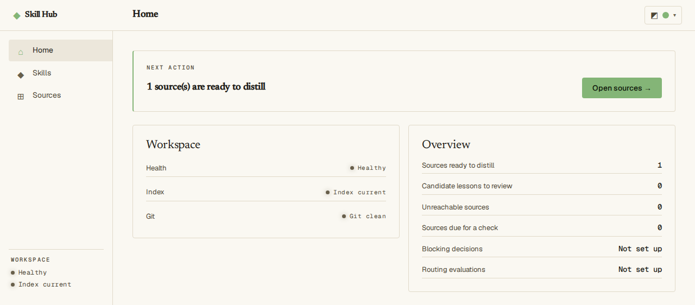<br><em>Home: what needs attention, and the one next step to take.</em>

### Find a skill

1. Open **Skills**.
2. Type part of a name or id in **Search**, or narrow the list with **Lifecycle**, **Collection** or **Upstream**.
3. Click a row to open the skill. The **Routing** column says whether agents can be recommended the skill (**Routable**) or not yet (**Not routed**).

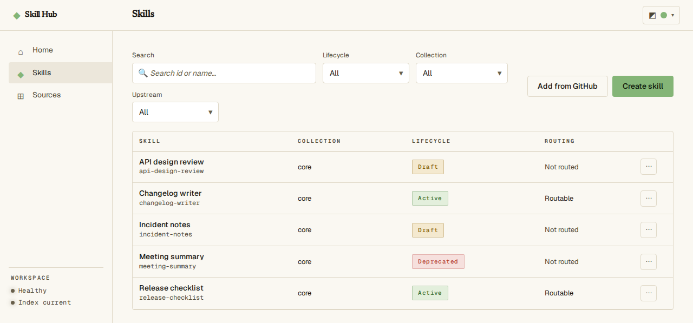<br><em>Skills: every skill with its state, and filters to find one.</em>

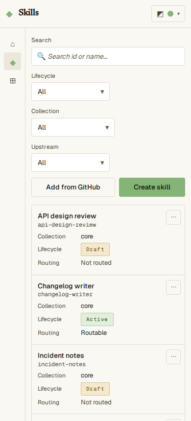<br><em>The same list on a 390 px wide screen.</em>

### Check one skill

Open a skill, and the **Overview** tab opens first. Its cards are **About**, **Routing** (when an agent is offered the skill), **Provenance** (where it came from) and **Sources**. **Edit** opens the editor and **Manage sources** opens the **Sources** tab.

The **Review** tab tells you whether agents can use the skill. **Validity** says whether the skill file follows the required format.

**Activation readiness** lists what a draft still needs. **In Git vs what agents see** tells you whether the search index matches the files.

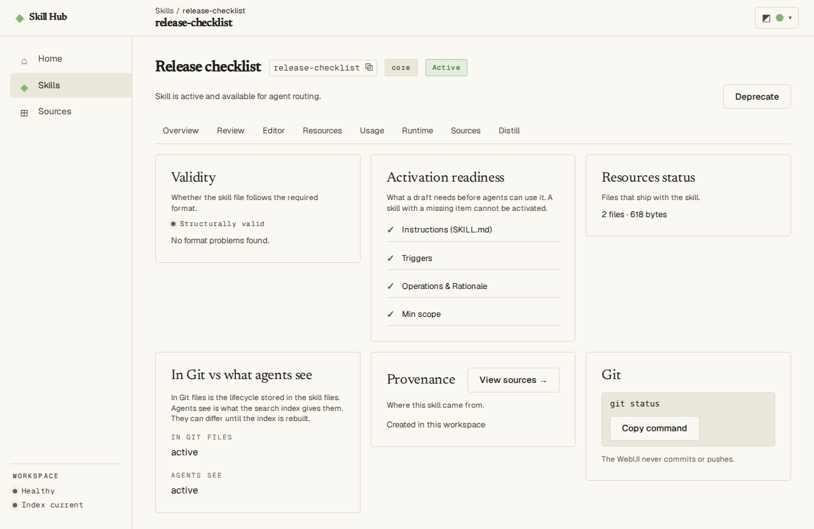<br><em>Review: whether agents can use this skill, and what to check first.</em>

A skill you added from someone else's repository also shows a **Content trust** card. Agents get no content from such a skill until you read it and approve it.

This is **content approval**, and it happens only in your terminal. The card shows the exact command to copy. Here `<digest>` is a fingerprint of the content you reviewed.

```bash
skillhub skill edit <skill-id> --approve-content <digest>
```

If a draft is not ready, the page says so next to the **Activate skill** button. Each missing item has a **Go to field** link that opens the editor on that field.

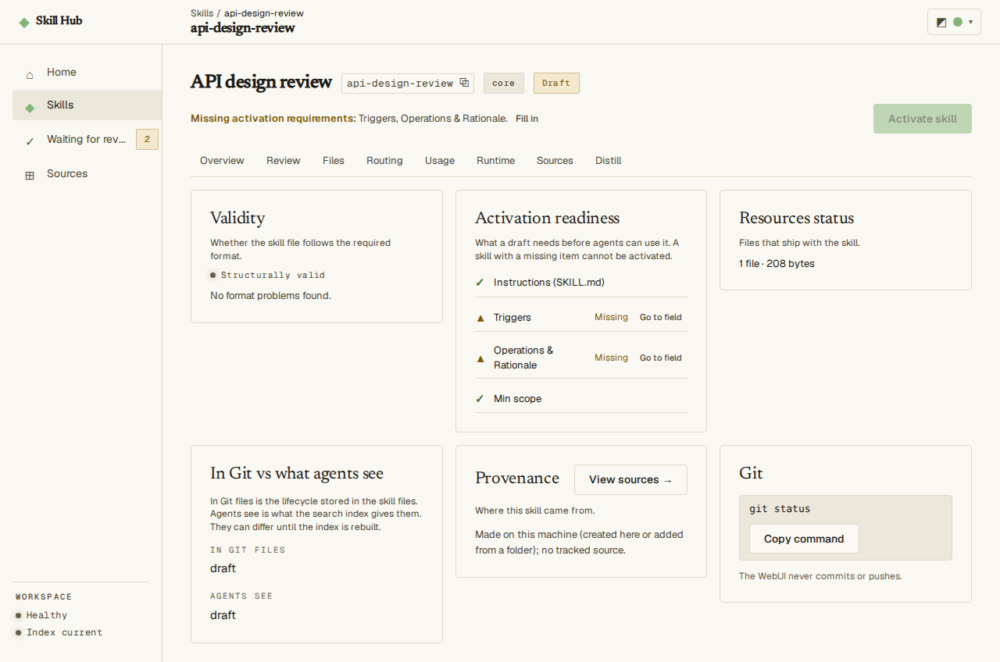<br><em>A draft that cannot be activated yet, with links to the fields to fix.</em>

The **Resources** tab lists the skill's companion files: scripts, reference documents and other files next to its `SKILL.md`. You change `SKILL.md` itself in the **Editor** tab.

- **Edit** opens a simple editor for a text file up to 1 MiB. A Markdown file also shows how it will read.
- **Preview changes** shows the exact change to that one file. Nothing is written until you confirm it.
- A binary file, or a text file larger than 1 MiB, opens read-only with **View**.
- If the file changed on disk meanwhile, you choose to keep your edits on the latest version or discard them.

The file in the skill folder is the record, and Git keeps its history, so commit the change yourself. Editing a file of a skill from another repository changes its content. Agents then get no content from that skill until you approve it again in your terminal.

### Activate, deprecate or archive a skill

1. Open the skill and click **Activate skill** (or **Deprecate** for an active one). The button stays off until the draft is ready.
2. A confirmation lists the files that will change and says in words what changes. Open **Exact file changes** to see the patch.
3. Click **Activate skill** in the confirmation to save, or **Cancel** to leave everything as it was.

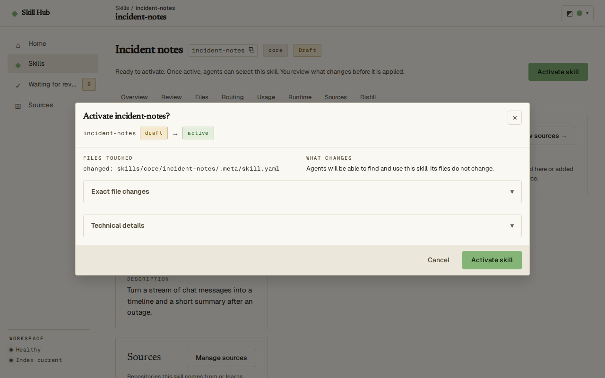<br><em>Activate: the confirmation that shows what changes before anything is saved.</em>

Skills move in order: draft, active, deprecated, archived. A **draft** is not offered to agents yet, and an **active** skill can be.

A **deprecated** skill is being phased out, and an **archived** one is retired and kept for history. To archive a deprecated skill, run `skillhub skill archive <skill-id> --yes` in the terminal. Without `--yes` it only shows what would change.

### Fix a skill's description and routing fields

1. Open the skill and choose the **Editor** tab.
2. Change the fields. Each routing field has a short explanation and an example under it. Your draft is kept in this browser while you work.
3. Click **Preview changes**. The dialog lists the files touched and describes the change in words.
4. Click **Save changes** to write it, or **Cancel**.

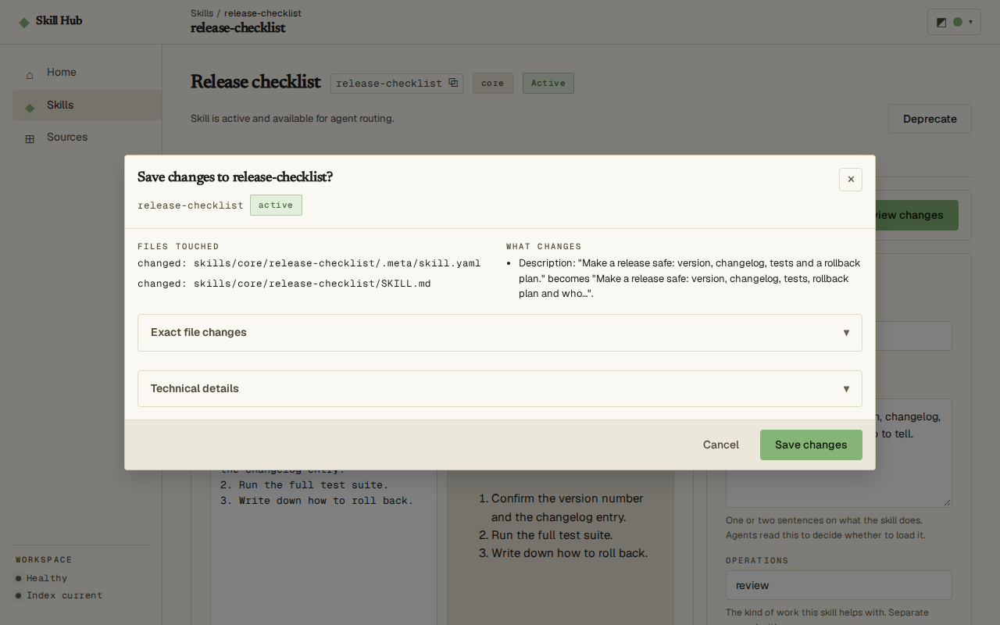<br><em>Editor: preview the exact change before it is saved.</em>

The skill may change somewhere else while the form is open, for example from the terminal. Then a drawer opens when you preview. It shows what you changed and what changed meanwhile, and warns when both touched the same field.

Choose **Keep my edits on the latest version** to apply them on top of the saved version. Choose **Discard my edits** to drop them. **Copy draft** and **Download draft** keep a copy of your text first.

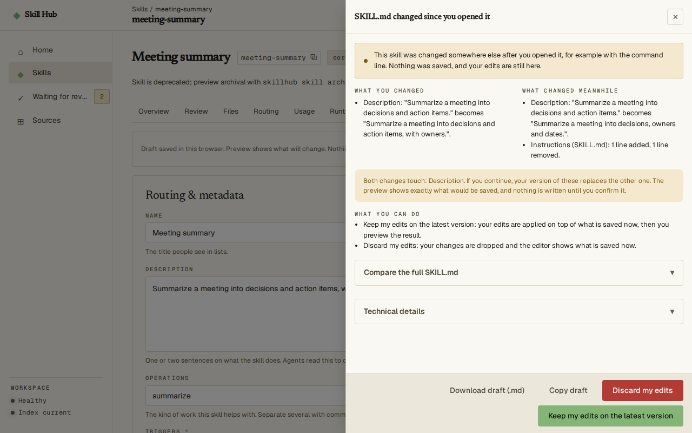<br><em>Conflict: the skill changed somewhere else while the form was open.</em>

### Create a skill

1. Open **Skills** and click **Create skill**.
2. Fill in the skill id, display name and description. You cannot change the id later.
3. Fill in the routing fields (operations, triggers, not for, minimum scope). You can leave them empty now, but activation needs them.
4. Click **Preview draft**, check the files that will be written, then confirm.

The new skill is a draft: agents do not use it until you activate it.

<details>
<summary>See the create skill form</summary>

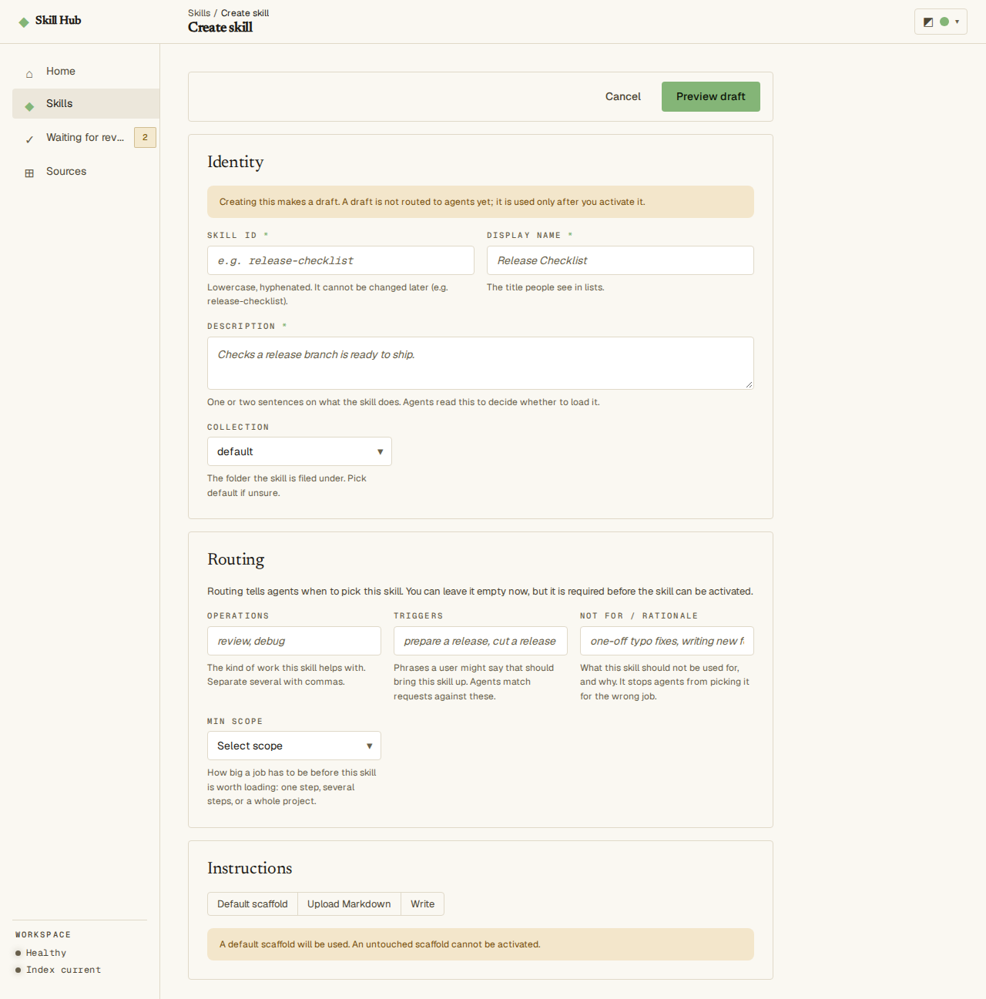<br><em>Create a skill: the form tells you which fields are needed to activate it later.</em>

</details>

### Add skills from GitHub

1. Open **Skills** and click **Add from GitHub**.
2. Paste the address of a public repository, or of a folder or file inside it, and click **Discover skills**. Discover only looks: it lists the skills it finds and writes nothing.
3. Read where the skills come from, the revision, the trust note, the files that would be written and any conflicts. Choose the skills (or **Import all**), then click **Confirm import**.

Imported skills start as drafts. A skill from someone else's repository also needs your content approval before agents receive it (see [Check one skill](#check-one-skill)).

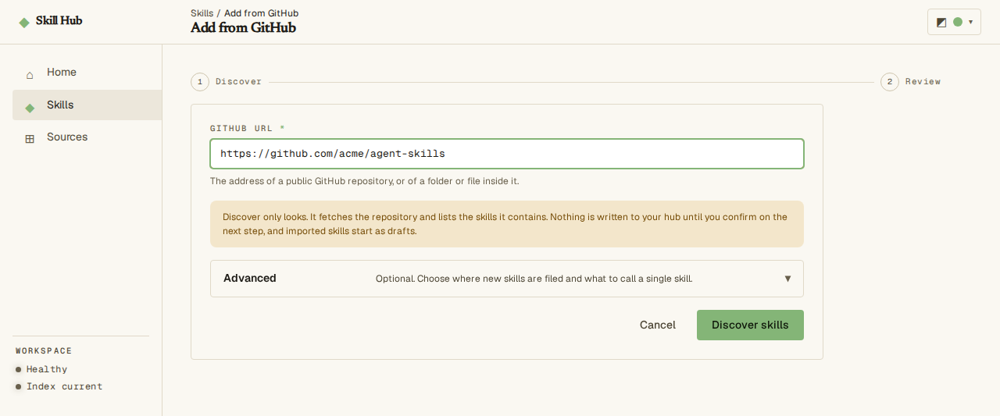<br><em>Add from GitHub: paste a repository address to find skills in it.</em>

### Act on upstream updates

A skill added from GitHub remembers its **upstream**: the source it was copied from, whose updates you can pull.

1. In **Skills**, set **Upstream** to **Has an update**. To refresh that first, click **Check now** in a skill's **Sources** tab, or run `skillhub skill outdated --check`.
2. Open a skill marked **Update available** and click **Review update**.
3. For each changed file choose **Take upstream**, **Keep mine** or **Edit manually**, then click **Apply choices**.

### Manage one skill's sources

A **source** is a Git repository linked to one or more skills. Your **curator agent** is your own agent with the distill-lab skill. It reads sources and records **lessons**, proposed improvements you decide on.

Open a skill and choose the **Sources** tab. It lists the skill's upstream and every **learning reference**: a source your curator agent reads for ideas, with nothing copied. A skill with neither shows **No sources yet**.

**Add a learning reference.** Click **Add source**, then choose **Link a watched source** or **Watch a GitHub repository**. Click **Preview** to see the files that would be written, then **Add source** to confirm. **Unlink** removes a reference again.

**Track an upstream.** An older skill copied from GitHub shows **Not tracked**, so the hub cannot check it for updates. Click **Track upstream** to see the exact change, then confirm. The terminal equivalent is `skillhub source backfill --skill <skill-id>`.

### Link and check sources

Open **Sources**. It lists every source, for learning or for updates. Each row shows when it was last checked and what that check found.

**Changed** means it has commits no skill has learned from yet. Checks run only when you ask: **Check now** on one row, or **Check due sources** or **Check all** for many. The terminal equivalent is `skillhub check`.

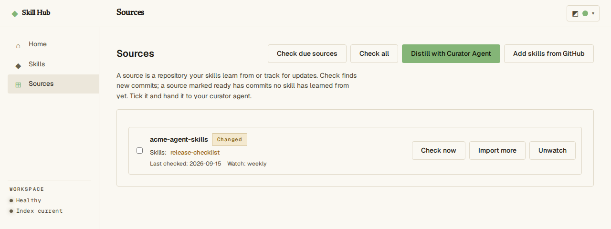<br><em>Sources: where skills learn from, and when each was last checked.</em>

### Hand a source to your curator agent

Your curator agent reads the sources you pick and records lessons for each skill.

1. On **Sources**, tick the sources you want learned from and click **Distill with Curator Agent**.
2. Click **Copy handoff** and paste the text to an agent that has the distill-lab skill.
3. The agent records its lessons in each skill's `.meta/distill.yaml`. Read them in the skill's **Distill** tab, where you decide what to keep.

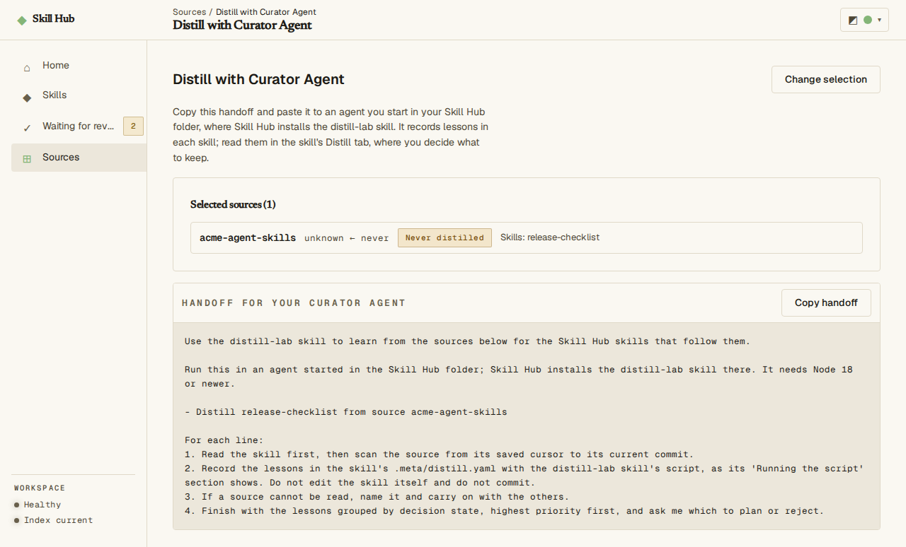<br><em>Distill: copy the brief and give it to your curator agent.</em>

### Change the theme

Use the appearance button at the top right of any screen to switch between light, dark and the system setting.

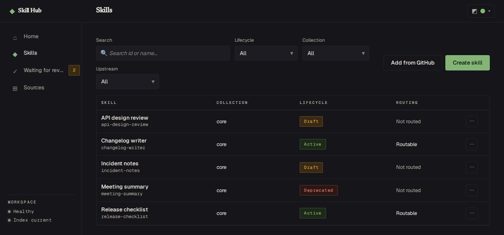<br><em>The same list in the dark theme.</em>

## Keep it safe on your network

The web UI speaks plain HTTP and guards each session with the token in its address.

> [!WARNING]
> Traffic is not encrypted. Anyone who can watch your network can read the token. Use `--loopback-only` on shared networks, and never expose the web UI to a public network without a TLS reverse proxy.

<details>
<summary>How the web UI chooses an address, and how to change it</summary>

When your machine has two or more IPv4 addresses besides `127.0.0.1`, the web UI listens on all of them. Wi-Fi, Ethernet, Docker bridges and a VPN each add one. It then prints a warning and one extra address per network interface:

```text
WARNING: The web UI is reachable from other devices over plain HTTP. Anyone who can observe this traffic can read the session token. Use --loopback-only to keep it on this machine.
Skill Hub web UI: http://127.0.0.1:7421/#token=<token>
  <interface>: http://<ip>:7421/#token=<token>
```

On a machine with one network address, it listens only on `127.0.0.1`. To keep it on this machine in every case, run `skillhub serve web --loopback-only`.

To choose the address and port yourself, use `--addr`, for example `skillhub serve web --addr 127.0.0.1:8080`.

To reach the web UI through another hostname, such as a reverse proxy, add `--allow-host <host[:port]>`. You can repeat the flag. Requests with any other hostname get `421 Misdirected Request`, which blocks DNS rebinding attacks.

</details>
