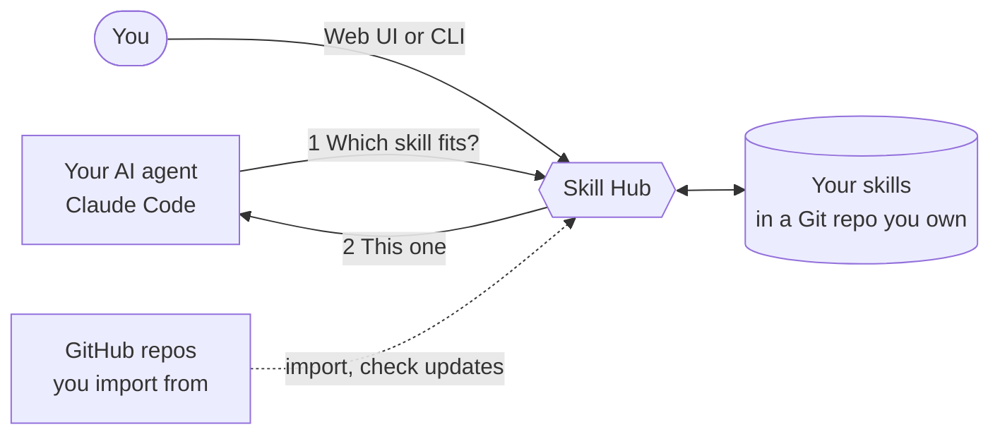

# Docs rewrite: discussion synthesis and decisions

Source: four independent expert reviews (reader and value story, verified quickstart, doc set and
structure, voice and presentation) run on 2026-10-11, plus the owner's brief. This file is the input
for the plan; where it says "decided", the plan must not reopen it.

## Owner's brief

Rewrite the README and the user guide in a marketing/sales-friendly style, easy to understand, nicely
presented, comfortable to read. The reader path: understand what the system is worth to them -> want to
use it -> install it right away -> use it right away (connect an agent and add a skill). Aim for a basic
first win so they feel the value; deep usage gets its own guides.

## Value story (true to the product; verified against docs and code)

Promise: keep one curated library of agent skills in your own Git repo, and let every project's agent
pull the right skill when it needs it, with no copying.

1. One library, every project: `connect` (or `connect -g`) registers the hub; stop copying skill folders.
2. The right skill without bloating context: the agent sends a short task description, the hub replies
   with a recommendation or "no skill fits", the full skill text loads only after the agent picks one.
3. You stay in control: skills are plain files in your Git repo; new skills start as drafts; skills from
   someone else's repo give no content to agents until you approve them in the terminal; upstream
   updates arrive as a 3-way merge; the hub never commits or pushes for you.

Personas: multi-agent developer (main), skill collector, lead with a shared skill set (secondary: sharing
works because the workspace is a Git repo teammates clone; there is no multi-user server).

Taglines to choose from: "One skill library. Every agent. Every project." / "Stop copying skills between
projects. Serve them from one Git repo." / "Your agent skills, curated in Git and delivered when the task
needs them."

## Claims that must NOT appear (not backed by the product)

- "Works with Claude Code, Codex and Gemini CLI" without qualification. Only Claude Code is verified
  (docs/mcp-compatibility-matrix.json); Codex and Gemini are `blocked_unverified`; Claude Desktop and
  Cursor are `unverified` and `connect` has no host for them. Honest wording: works with Claude Code; also
  sets up Codex and Gemini CLI connection files (not yet verified end to end).
- "semantic", "AI-powered", "embeddings": matching is metadata plus SQLite full-text search; the LLM
  reranker exists but is off.
- Automatic watching or weekly automation: `source watch` only records an interval; nothing runs in the
  background.
- "The hub learns/distills for you": the user's own agent does that with the distill-lab skill.
- "The agent always asks the hub": say "your agent is told to ask the hub".
- Remote hub (`connect --hub`): not shipped; leave it out of user docs entirely.

## The first win (verified by running it in a sandbox)

Shortest true path, proved over the real MCP stdio server (3 tools: skill_feedback, skill_get,
skill_resolve) and the CLI:

```text
skillhub init ~/skillhub --yes
git -C ~/skillhub add <chosen files> && git -C ~/skillhub commit -m "Initialize Skill Hub workspace"
cd ~/myproject && skillhub connect --workspace ~/skillhub --host claude --yes
skillhub skill create commit-style --collection core --name "Commit style" \
  --description "Write git commit messages in our team style" --content-file commit-style.md \
  --operation document --trigger "write a commit message" --not-for "writing release notes" \
  --min-scope single_step --example "write a commit message for my staged changes" --yes
skillhub skill activate commit-style --yes
skillhub resolve --request req.json     # req.json has task.description and task.scope, see below
```

- A first win uses a LOCAL skill (decided): local skills are trusted, there is no approval step, and it
  works offline. The GitHub path (add, review, approve content digest, fill routing fields, activate)
  has four gates and belongs in the next guide, not in the first win.
- The create command must be shown complete in one go: activation refuses a draft without `--trigger`,
  `--not-for` and `--min-scope`.
- Visible proof: the example skill ends commit messages with a marker line (e.g. `Checked-by:
  skillhub-demo`), so the reader sees the skill was used. Sanity checks: `skillhub doctor` prints
  "Workspace is healthy."; `skillhub skill list` shows the skill as `active`; `skillhub resolve` prints
  "Resolved commit-style"; in Claude Code `/mcp` lists `skillhub` with 3 tools.
- The resolve request JSON must carry `scope` inside `task`:
  `{"schema_version":"1","request_id":"r1","task":{"description":"write a commit message for my staged
  changes","scope":"single_step"},"operation":"document"}`. The user guide's current resolve example omits
  scope and always returns a question instead of a match.
- No starter skill is shipped (decided; it would be new product scope). The guide supplies the skill file
  as a copy-paste block.
- No GIF (decided): use a short text transcript of the exact commands and the output, trimmed.

## Traps newcomers hit (docs must steer around them; fixing the product is a separate follow-up)

- `init` writes `.mcp.json`, `.claude/settings.local.json`, `.codex/`, `.gemini/` into the hub with
  absolute machine paths; the hub `.gitignore` does not cover them, so `git add -A` commits them. The
  user guide already warns against it. The docs must not tell readers to run `git add -A` in the hub;
  they commit only the paths they mean (for example `skills/`, `sources/`, `.gitignore`, and the schema
  files that `init` created; the writer determines the exact safe list by running it).
- Bare `skill create` leads to a skill activation refuses (see above).
- `validate` says active skills "require at least 3 examples" but activation succeeds with fewer: say
  "recommended".
- Help example `skill add https://github.com/anthropics/skills --skill pdf` fails (8 MiB source limit);
  `--path skills/pdf` or a `/tree/main/skills/pdf` URL works. Docs use a working form.
- After `connect -g`, running the CLI in an unrelated folder says "No Skill Hub workspace was found": docs
  mention `SKILLHUB_WORKSPACE`.
- "Restart your agent" should read "open a new Claude Code session in that folder".
- `skillhub --version` is unsupported; the command is `skillhub version`.
- Product follow-ups (OUT of scope for this branch; list them in the plan's "follow-ups" so the owner can
  decide): resolve hint prints `task.scope` as a flat key that the API rejects; help example above
  fails; `init` should gitignore connection files; `status` on an empty hub says "Next: continue normal
  work"; `skill review` shows `Git: clean` for an untracked skill folder; activation message suggests
  `git commit` without `add`.

## Doc set (decided)

| File | Action | Purpose | Budget (lines) |
|---|---|---|---|
| README.md | rewrite | pitch, 60-second quickstart, docs map | <= 130 |
| docs/getting-started.md | new | install -> workspace -> connect -> create a skill -> first win | 150-220 |
| docs/installation.md | new (moved from README and runbook) | install options, pin a version, signatures, upgrade, uninstall, build from source | <= 90 |
| docs/user-guide.md | rewrite as "Using Skill Hub" | concepts, connecting agents (keep "What gets written"), how the agent picks a skill, skills that need tools or secrets, moving machines | <= 250 |
| docs/web-ui.md | new (moved from user-guide and README) | web UI tasks with screenshots, network and security | <= 200 |
| docs/troubleshooting.md | new (moved from user-guide) | symptom -> fix | <= 150 |
| docs/curating-skills.md | trim | add, create, review, edit, lifecycle, commit, routing quality | <= 350 |
| docs/sources-and-learning.md | new (moved from curating-skills) | upstream drift and updates, watch, check, distill, inbox | <= 280 |
| docs/command-reference.md | new | one merged command table (the two existing tables disagree) | <= 90 |
| docs/README.md | new | docs index by audience: users, maintainers, design records | <= 50 |
| CONTRIBUTING.md (repo root, decided) | new (from README "Development") | dev commands, test isolation, link to the release runbook | <= 60 |
| docs/release-runbook.md | trim | drop duplicated install text; link installation.md | ~160 |

Leave alone: docs/PRD.md, docs/design/*, docs/use-cases/*, docs/contracts/*, docs/references/*,
docs/distillery/*, docs/brainstorm/*, docs/plans/*, system-skills/*, AGENTS.md, CLAUDE.md, GEMINI.md.
Design records (mostly Vietnamese) are linked ONLY from docs/README.md under "for maintainers" (decided),
never from README or the user guide; the user guide drops its links into plans/ and Vietnamese anchors.

Hard constraints from the code and tests:
- `docs/mcp-compatibility-matrix.json` must not move (internal/hostintegration/matrix_test.go reads it).
- `docs/images/web/` and `manifest.json` are written by `make web-shots`; keep the path; reuse manifest
  captions and alt text. Do not regenerate screenshots in this branch except where noted below.
- Nothing in code, CI or tests links to README/user-guide/curating-skills/release-runbook (verified).
- No CI check covers docs links; the plan's last step is a local relative-link and anchor check.
- Keep these inbound anchors alive: `README.md#quickstart`, `docs/user-guide.md#what-gets-written`,
  `docs/user-guide.md#do-common-tasks-in-the-web-ui`. For every H2 that moves out of user-guide.md or
  curating-skills.md leave a short stub heading ("Moved to [x](x.md)") at the old place (decided: keep
  the stubs; no removal date).
- Fix the broken link at user-guide.md:115 (plan path); better, drop plan links from user docs.
- Remove release-wave and host-version notes ("wave-4", "verified on Claude Code 2.1.296", "in this
  wave") and catalog/JSON-pin internals from user docs; point to docs/contracts/ instead.

## README outline (decided)

1. Name, one-line value, 2-3 sentence pitch (<= 5 lines).
2. Hero image: `skills-list.png` with a dark twin via `<picture>` (`dark-skills-list.png`). Do not use
   `home.png` as the hero (shows the awkward "1 source(s)" copy).
3. Why Skill Hub: 5 benefit bullets (agent asks for the right skill; you approve every change; no server
   or daemon, a single binary; Git is the database; a local web UI).
4. How it works: 3 steps plus the mermaid diagram below.
5. Quickstart (keep the heading text "Quickstart"): install one-liners, init and commit, connect, open a
   new session, one prompt. Ends with "Add your first skill -> Get started".
6. See it: `skillhub serve web`, one or two screenshots, link to web-ui.md.
7. Works with: honest agent table (see claims above), link to the matrix JSON.
8. Documentation: links grouped Start, Guides, Reference, Maintainers.
9. Contributing and license: the owner chose the MIT license (decided). Add a standard MIT `LICENSE` file
   at the repo root (copyright holder "Van Tran", year 2026, taken from the repo's git author; flag it
   in the report so the owner can correct the holder name), a license badge and one line in the README.

Header block: a designed logo (decided by the owner: design a real logo, not just the text wordmark;
see "Owner decisions of 2026-10-11" below), tagline, badges: latest release, CI and license (MIT), link row Quickstart · User guide · Curating skills. Skip stars,
downloads, coverage, "PRs welcome".

Mermaid diagram (validated with mermaid-cli):



## Get started outline

0. Intro: what you will have at the end, about 10 minutes, prerequisites (Git, Claude Code).
1. Install (one-liners; check with `skillhub version`; link installation.md).
2. Create the workspace (one sentence on what it is; `init`; commit only the safe paths).
3. Connect your agent (per project or `-g`; open a new session; check with `skillhub doctor`; one line on
   what gets written, linking `user-guide.md#what-gets-written`).
4. Create your first skill (complete command, the copy-paste skill file with the marker, activate; one
   line each on draft and active).
5. First win (ask the agent a matching task; what you should see; manual check with `skillhub resolve`;
   sanity checks).
6. Optional: see it in the web UI.
7. If it did not work: four quick fixes, link troubleshooting.md.
8. Next steps: add a skill from GitHub (curating-skills.md), sources and learning, web UI tour.

## Voice and presentation (decided)

- Language: English only now (decided). A `README.vi.md` is deferred; if the owner wants one later it
  doubles README maintenance. The plan lists it as an optional follow-up.
- Voice: plain, warm, confident; "you", present tense, active voice; sentences <= 20 words; paragraphs <=
  3 sentences; benefit first, then steps. No emoji, no exclamation marks, no "simply", "just", "easy",
  "powerful".
- Terms: use the glossary the plan freezes (skill, hub, workspace, agent (not host), draft/active, source,
  upstream, learning reference, content approval). Keep internal terms (catalog generation, served or
  canonical state, digest, proposal ID, provenance, vendored, 3-way merge, daemon) out of README and the
  first screens of guides; explain each product term once, in one line, where it first appears.
- Presentation: GitHub alerts (at most one per screen; IMPORTANT for "Skill Hub never commits or pushes for
  you", WARNING for plain HTTP, CAUTION for committing connection files, TIP for `-g`), `<details>` for
  install options, network binding, permission rules, Windows notes, and the tall `create-skill.png`.
  Code blocks: no `$` prompts, language tag, one action per block, a sentence above saying why, expected
  output in a separate `text` block, placeholders as `<skill-id>`. One image per task, alt text and a
  one-sentence caption, width 800 (phone shots 260). Every image <= 300 KB.
- Before/after voice example (use as a calibration, not as final copy):
  - Before: "Skill Hub keeps one curated, Git-backed collection of agent skills and shares it with Claude
    Code, Codex, and Gemini CLI across all your projects."
  - After: "One set of skills. Every agent. Every project. Skill Hub gives your agent the same hand-picked
    skills, wherever you work. When your agent starts a task, it asks the hub which skill fits, and the hub
    suggests one. Nothing changes without your say-so."
- Style guide (14 rules) for writers: you/present/active; one idea per sentence; benefit first; explain each
  term once; avoid-terms stay out of README; task headings start with a verb in sentence case; code block
  conventions above; bold only UI labels and key terms, `code` only for things you type or file names;
  every image has alt text and a caption, width 800; one callout per screen; long reference in `<details>`
  or a separate page; no emoji or hype words; say plainly what Skill Hub never does (commit, push,
  approve); same word for the same thing everywhere.
- Pre-publish checklist: every link and anchor resolves; every command was run on a clean HOME and the
  shown output matches; every image exists, has alt text and is <= 300 KB; rendered preview in light and
  dark mode and mobile width; spelling and product names (Claude Code, Codex, Gemini CLI, GitHub); tone
  pass against the style guide; badges point to real targets.

## Known gaps to flag to the owner (not for the writers to solve)

- No LICENSE file in a public repo (owner decides the license).
- `home.png` shows the copy "1 source(s)"; fix the UI copy and re-shoot before featuring it.
- An agent actually using a skill in a live Claude Code session was not demonstrated by the reviewers
  (the matrix verifies registration and curation only); the guide must say what the reader should see and
  must not promise more than the MCP stdio proof shows.
- The installed binary reported `version: dev`; writers re-run commands with a binary built from main.

## Owner decisions of 2026-10-11 (final; they override anything above)

1. License: MIT. Add `LICENSE`, a license badge and a README line. Copyright holder "Van Tran", 2026.
2. Fix the web UI copy "1 source(s)" on the Home screen (proper singular/plural wording), cover it with a
   test, rebuild, and re-shoot `home.png` so it can be featured. This touches `web/` and
   `docs/images/web/`; give it its own phase with its own owned files, run it in parallel with the
   writing phases, and re-run `make web-shots` only for what the copy fix changes (or all shots if the
   harness cannot do one). The README hero stays `skills-list.png`.
3. Move the README "Development" section and the user guide's internal notes (wave and version details,
   Vietnamese plan links) into CONTRIBUTING.md and the reference pages: confirmed.
4. Logo: design a real logo. The product look is calm and editorial: warm off-white background, serif
   headings, a sage-green accent and a green diamond mark next to a serif "Skill Hub" wordmark (see the
   screenshots in docs/images/web/). Deliver SVG files under `docs/images/brand/` (a horizontal logo
   with wordmark, a square mark, light and dark variants, each small and valid), use them in the README
   header with `<picture>` for light and dark mode, and consider using the mark as the web UI's favicon
   only if that is cheap and safe (otherwise list it as a follow-up). The design phase must use the
   `/ak:frontend-design` skill (or the `ui-ux-designer` agent) and must be checked by rendering the SVGs
   to PNG at several sizes (16, 32, 128, 512 px) and looking at them; no raster-only logo.
